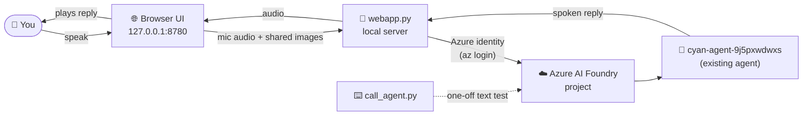

<div align="center">

# 🎙️ Azure Voice Agent

**A voice-first browser app for talking to your existing Azure AI Foundry agent, with optional image context.**


[Quick start](#-quick-start) · [How it works](#-how-it-works) · [Images](#-share-images-with-the-agent) · [Configuration](#-configuration) · [Troubleshooting](#-troubleshooting)

</div>

---

## ✨ Highlights

- 🗣️ **Talk naturally.** The session starts automatically, mic audio streams in, and the agent replies aloud.
- 🖼️ **Show, don't just tell.** Share up to **5 images** (JPEG, PNG, WebP) as visual context, then ask about them by voice.
- 🔒 **Safe by design.** Binds to `127.0.0.1` only. The app **never creates, updates, or deletes** the agent.
- 🧪 **Quick text test.** `call_agent.py` sends a one-off message from the terminal.

> **Target agent:** `cyan-agent-9j5pxwdwxs` (existing, managed outside this app)

---

## 🧭 How it works



| Component | Role |
|---|---|
| **Browser UI** | Captures the microphone, plays replies, manages image sharing |
| **`webapp.py`** | Local bridge on `127.0.0.1:8780`; authenticates with your Azure identity |
| **Foundry project** | Hosts the agent and applies its retention settings |
| **`call_agent.py`** | Standalone text-only smoke test |

---

## 🚀 Quick start

### 1. Prerequisites

- Python 3.10+
- [Azure CLI](https://learn.microsoft.com/cli/azure/install-azure-cli)
- An Azure identity with permission to use the Foundry project
- A microphone (a **headset** is recommended to avoid echo)

### 2. Install

```powershell
python -m venv .venv
.\.venv\Scripts\Activate.ps1
python -m pip install -r requirements.txt
az login
```

### 3. Run the voice app

```powershell
python .\webapp.py
```

Open **<http://127.0.0.1:8780>** and allow microphone access. The voice session starts on its own. Just start talking.

> If your browser's audio policy blocks auto-start, click **Retry**.

---

## 🖼️ Share images with the agent

Images are **visual context inside the same voice session**, not text-chat prompts.

1. Click **Add image** (up to 5; JPEG, PNG, or WebP).
2. Click **Share with agent**.
3. Ask your question **out loud**.

> ⚠️ The model configured on the existing agent must support **image input**.

---

## 🧪 Text test (no browser)

```powershell
python .\call_agent.py --message "Hello! Please briefly introduce yourself."
```

Omit `--message` to be prompted interactively. The project endpoint and agent name are defined near the top of `call_agent.py`.

---

## ⚙️ Configuration

Defaults live in `webapp.py`. Override them with environment variables:

| Variable | Purpose |
|---|---|
| `AZURE_AI_PROJECT_ENDPOINT` | Foundry project endpoint |
| `AZURE_VOICE_AGENT_NAME` | Name of the existing agent to connect to |

```powershell
$env:AZURE_AI_PROJECT_ENDPOINT = "https://<your-project-endpoint>"
$env:AZURE_VOICE_AGENT_NAME    = "cyan-agent-9j5pxwdwxs"
python .\webapp.py
```

---

## 🛡️ Security & privacy

- **Localhost only.** The app stays bound to `127.0.0.1`. **Do not expose it to a network.**
- **Read-only toward the agent.** It does not create, update, or delete it.
- **Retention is not changed here.** Image and audio retention follow the existing agent and Foundry project settings.

---

## 🩺 Troubleshooting

| Symptom | Try this |
|---|---|
| Authentication or permission errors | Run `az login` again and confirm your identity has access to the Foundry project |
| No audio / session doesn't start | Click **Retry**; check the browser's microphone permission |
| Echo or feedback | Use a headset |
| Image questions aren't understood | Confirm the agent's model accepts image input and that you clicked **Share with agent** |
| Wrong agent or project | Set `AZURE_AI_PROJECT_ENDPOINT` / `AZURE_VOICE_AGENT_NAME` |

---

## 📁 Project layout

```text
.
├── webapp.py          # Local voice-first web app (127.0.0.1:8780)
├── call_agent.py      # One-off text test client
└── requirements.txt   # Python dependencies
```
